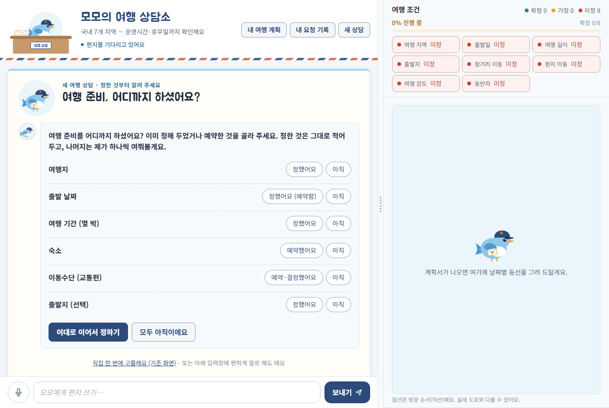
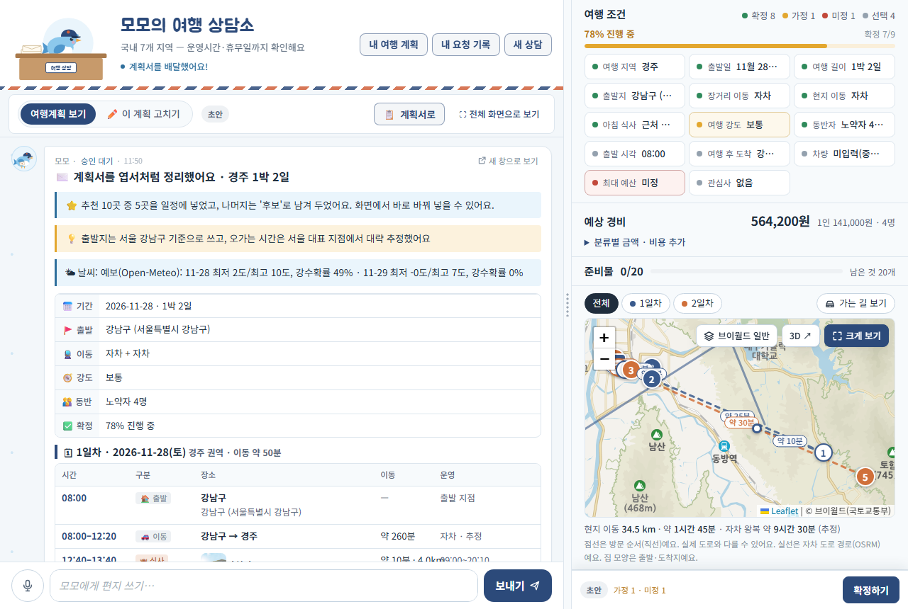
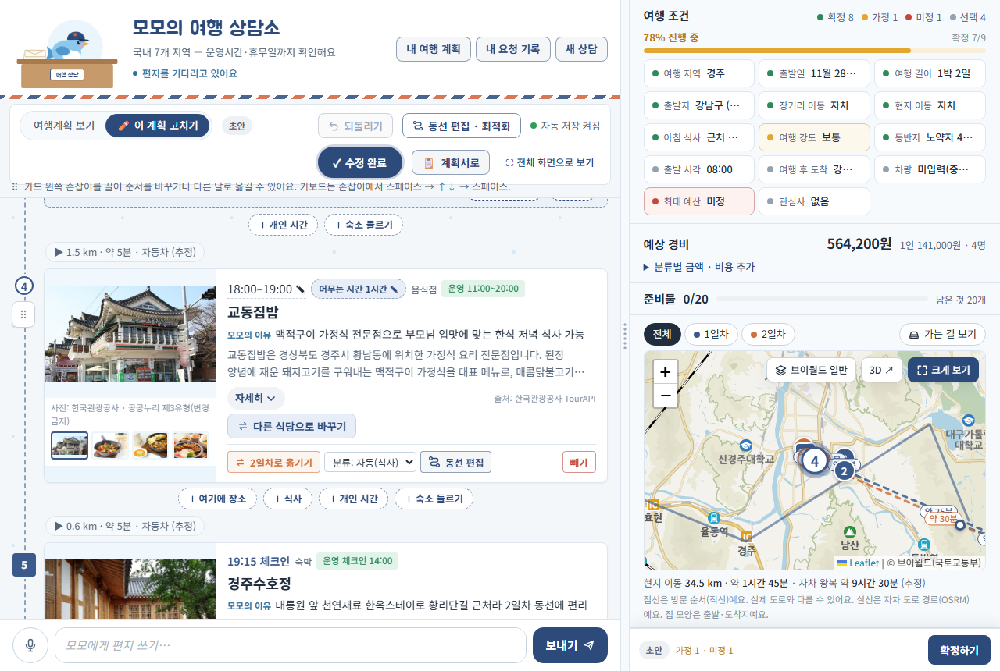
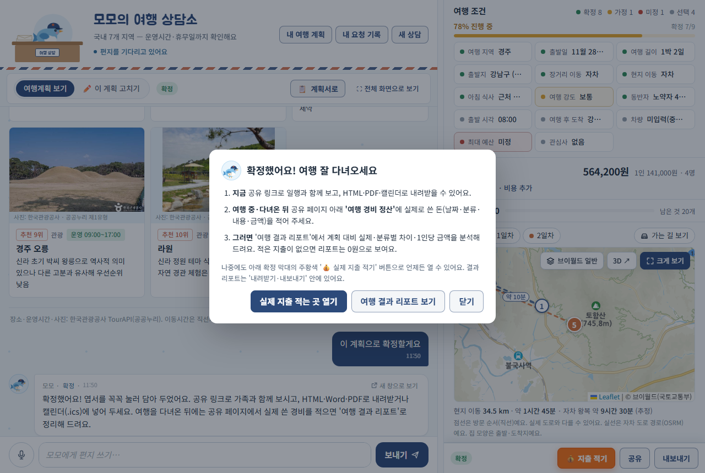
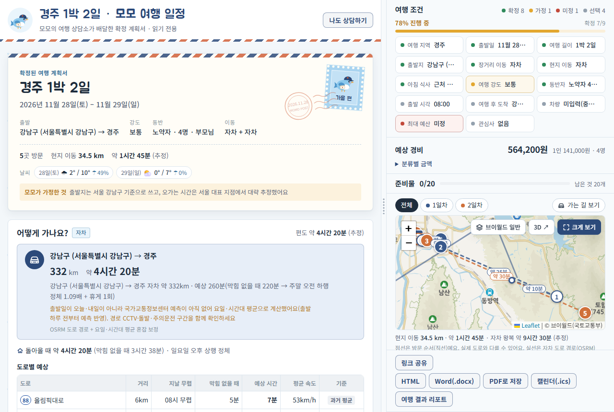
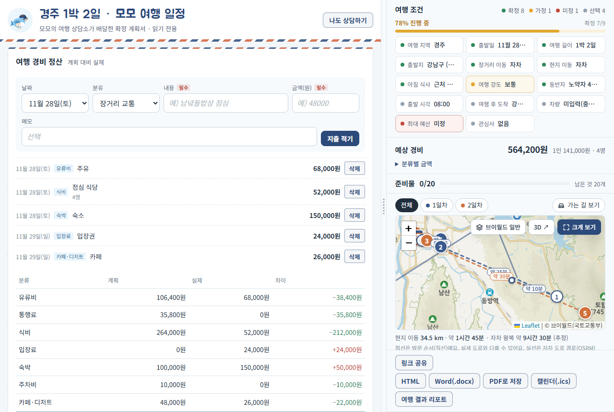
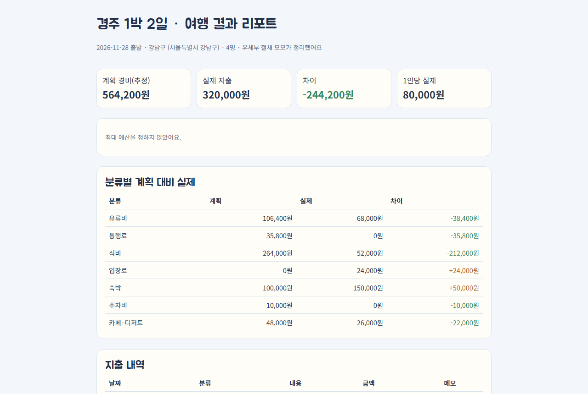
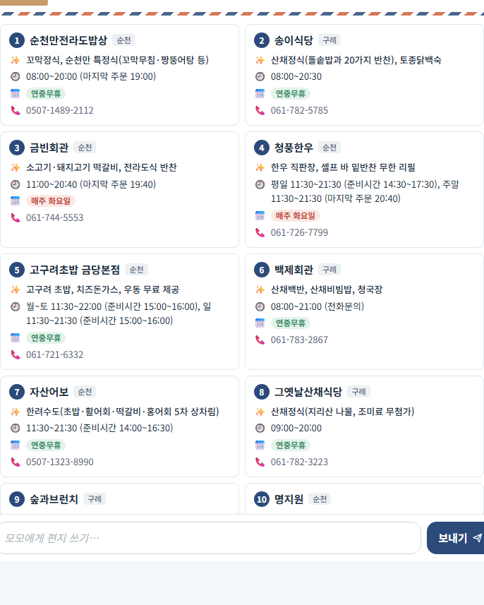

# 미니 PJT: 모모의 여행 상담소 (Momo Travel Counselor)

우체부 철새 '모모'가 상담하듯 대화하며, **운영시간·휴무일·축제·날씨·오가는 이동시간까지 반영한 "실제로 갈 수 있는" 국내 여행 일정**을 짜 주는 Agentic RAG 에이전트입니다.
대상 지역은 7곳(경주 · 순천/구례 · 수원 · 제주 · 강릉/동해/삼척 · 전주/완주/군산 · 통영/거제, 수집 장소 433곳)이며, 모든 장소는 한국관광공사 TourAPI 데이터를 근거로 합니다. 인-아웃 평가 세트는 경주·순천/구례·수원 기준입니다.

> 상세 기획: [SERVICE.md](SERVICE.md) · 실행 명세(Seed, 처음 범위 기준): [seeds/momo.seed.yaml](seeds/momo.seed.yaml) · 작업 이력: [HISTORY.md](HISTORY.md) · 협업 규칙: [AGENTS.md](AGENTS.md)

## 무엇을 푸나

블로그·지도 앱·관광 사이트를 오가며 일정을 짜도 **휴무일·운영시간·축제 날짜·날씨가 빠져 있어 현장에서 일정이 깨진다** — 이 문제를, 공식 데이터 근거와 코드 규칙 검사(휴무일·운영시간 밖·시간 겹침·없는 장소 0건)로 푼다.

- 주 사용자: 주말·연휴에 국내 당일~1박 2일 여행을 직접 계획하는 가족 여행자(최대 8박 9일까지 지원)
- 한 줄로 말하면 빠진 조건만 되묻고 일정 완성 → 카드형 계획서(사진·요약·운영시간 배지·지도·예상 경비·준비물) → 대화·화면에서 부분 수정 → 승인 후 확정·내보내기(.ics · 공유 링크 · HTML · Word · 인쇄)

## 활용한 패턴 (Day 1~7)

| Day | 패턴 | 어떻게 활용 | 코드 |
|:-:|---|---|---|
| 1 | LCEL + Pydantic 구조화 출력 | 조건 파싱(`ParsedRequest`), 장소 고르기(`PlanPick`)를 구조화 출력으로 받고, 실패하면 재시도·문자열 목록 파싱 | `src/shared/llm.py`, `src/counsel/schemas.py`, `src/planning/schemas.py` |
| 2 | RAG (하이브리드 검색) | BM25(kiwipiepy 형태소) + Chroma 벡터(Titan Embeddings v2)를 순위 융합(RRF)하고 제목 일치 가중. 벡터가 실패하면 BM25만으로 동작 | `src/places/retrieve.py:54` |
| 3 | ReAct (도구 자율 선택) | 정보 질문(운영시간·휴무·축제·날씨·맛집 추천)은 LangChain `create_agent`에 도구 4개(`retrieve_places`·`get_operating_info`·`search_festivals`·`get_weather`)를 묶어 LLM이 필요한 도구를 골라 호출하고, 결과만으로 답합니다 | `src/counsel/agent.py` `info_node`, 프롬프트 `src/counsel/prompts.py` `INFO_SYSTEM` |
| 4 | 도구 여러 개 | 운영정보·축제·날씨(Open-Meteo)·이동시간(OSRM 캐시·도로 경로)·장소 찾기(관광공사·브이월드·OSM)·지점 고르기를 한 질의에서 조합 | `src/places/tools.py`, `src/mobility/roads.py`, `src/places/placesearch.py` |
| 5 | 가드레일 | 입력: 개인정보 가리기·프롬프트 인젝션(직접·인코딩·간접) 차단. 출력: 시스템 프롬프트·키 형태 문자열 차단. 외부 데이터는 '데이터'로만 감싸 지시로 따르지 않음 | `src/guardrails/guardrails.py`, 그래프 `guard_in`/`guard_out` |
| 5 | HITL (승인) | 일정은 '승인 대기'로만 나오고, `action=approve` + `session_id`로만 확정·저장(`draft_version`을 함께 보내면 최신본인지 확인해 오래된 요청은 거절). 대화 글로는 확정되지 않음 | `src/counsel/agent.py` `approve_node` |
| 5 | 미들웨어 | LLM·trace·로그·공유 페이지에 들어가기 전 개인정보 가리기, 구조화 출력 재시도, 요청 중지(취소 신호 → 요청 전 상태로 되돌림) | `src/guardrails/guardrails.py`, `src/shared/cancel.py` |
| 7 | Plan-Execute · 메모리 | LLM은 장소·순서만 고르고 → 코드가 시각 계산 → 규칙 검사 → 위반 시 최대 2회 재생성 → 남으면 보정. 대화 상태는 LangGraph 체크포인트(SQLite), 상담 기록·되돌리기 목록 보존 | `src/planning/planner.py:1491`, `src/memory/store.py` |
| 7 | Observability · Trace | 모든 응답에 `trace`(단계·입력·출력, 개인정보 가린 뒤 기록), LangSmith 추적(환경 변수로 켜기, 프로젝트 `momo-travel` 4,783 traces) — 캡처: [목록](evaluation/screenshots/langsmith_trace_list.png) · [상세: guard_in → start → ChatBedrockConverse(PlanPick)](evaluation/screenshots/langsmith_trace_detail.png). 무료 월 한도 초과로 11-27부터 LangSmith 전송은 멈췄고, 2차 평가의 케이스별 trace는 `evaluation/reports/round2_responses.json`에 있습니다 | `src/counsel/agent.py`, `.env.example` |
| 7 | 평가 (RAGAS · LLM-as-Judge) | 규칙 검사 하드 게이트 + Judge(Claude Sonnet 4.6, 생성 모델과 다름) + RAGAS 4지표 | `evaluation/run_eval.py` |

필수 패턴 1·3·11·12를 포함해 10개를 적용했습니다(1·2·3·4·6·7·8·10·11·12). MCP와 Multi-Agent는 쓰지 않았습니다. ReAct는 정보 질문에만 쓰고, 일정 생성은 규칙 검사가 핵심이라 고정 흐름(Plan-Execute)으로 했습니다. 자율 도구 선택보다 결과가 안정적이고 재현되기 때문입니다. Multi-Agent는 기획 단계에서 범위 밖으로 정했습니다.

## 아키텍처

```
브라우저(src/api/static: 상담 화면 · 계획서 · 지도)      외부 클라이언트(LifeGalaxy 등)
        │  POST /query · /query/async(중지 가능)                │  POST /query
        ▼                                                       ▼
FastAPI  src/api/main.py ── 공유·내보내기(/plan/{id}, .ics, .docx, .html), 장소 찾기, 경비·준비물
        │
        ▼
src.counsel.agent.handle_query  ── LangGraph StateGraph (체크포인트: momo_state.sqlite)
  guard_in ─▶ parse(조건 파싱, 구조화 출력) ─▶ 라우터
     │            ├─ plan / modify : planner.build_plan
     │            │     후보 검색(RAG) → LLM 장소 고르기 → 코드 시각 계산(이동·식사·숙박·이동 중 끼니)
     │            │     → 규칙 검사(휴무·운영시간·겹침·없는 장소·식사·숙박) → 재생성 ≤2회 → 보정
     │            ├─ info   : 운영정보·축제·날씨 도구
     │            ├─ edit / setcond / cost / pack : 화면 편집(LLM 없이 재계산 · 되돌리기 20단계)
     │            ├─ approve : 승인 → 확정(plan_id · 공유 링크 · .ics)
     │            └─ reject  : 범위 밖·인젝션 거절
     └────────────▶ guard_out(출력 검사·개인정보 가리기) ─▶ {answer, contexts, trace, status, itinerary, plan …}

데이터: data/tourapi/<지역>/places.json(관광공사 수집 7개 지역 433곳 + 실시간 편입) · data/index/docs.jsonl(BM25) · chroma_db/(벡터, 생성 필요)
```

- 구조 다이어그램(코드 근거 링크 포함, archify): [앱 구조](.archify/momo-app-20261127-124708/momo-architecture.html) · [업무 흐름: 상담 → 계획 → 편집·확정 → 여행 후](.archify/momo-app-20261127-124708/momo-workflow.html) · [요청 흐름: /query/async → 계획서 → 확정](.archify/momo-app-20261127-124708/momo-plan-request.html) — 저장소를 내려받아 브라우저로 여세요.
- 소스는 모두 `src/` 아래에 **업무 도메인별 폴더**로 나뉩니다. 각 도메인 폴더에 실행 로직·프롬프트(`prompts.py`)·입출력 스키마(`schemas.py`)가 함께 있고, 여러 도메인이 쓰는 LLM 클라이언트·설정·유틸리티만 `src/shared/`에 둡니다(배치 규칙: `AGENTS.md` 4절).
- 가이드의 `src/` 구조와의 대응: `src/agent.py` → `src/counsel/agent.py`, `src/tools.py` → `src/places/tools.py`(+ `src/mobility/roads.py`·`src/places/placesearch.py`), `src/retriever.py` → `src/places/retrieve.py`.

```
src/
├── counsel/     상담 에이전트 그래프 · 조건 파싱 프롬프트/스키마 · 답변 말투·서식
├── planning/    일정 생성(LLM 고르기 + 시각 계산 + 규칙 검사) · 운영시간 · 계획서
├── places/      RAG 검색 · 장소 찾기 · 관광공사 실시간 조회 · ReAct 도구
├── mobility/    도로 경로·교통 정보 · 기차역·공항 거점
├── budget/      예상 경비
├── packing/     날씨·준비물
├── export/      Word·HTML 내보내기
├── memory/      확정 계획 저장(SQLite)
├── guardrails/  개인정보·인젝션 방어
├── api/         FastAPI + 웹 화면(static/)
├── ingest/      데이터 수집·요약·보강·색인 (오프라인)
└── shared/      LLM 클라이언트 · 페르소나 · 설정 · 데이터 로딩 · 공용 유틸
```

## 실행 방법

```bash
# 1) 환경 (Python 3.12 이상, 3.14에서 확인)
python -m venv .venv
.venv\Scripts\activate            # macOS/Linux: source .venv/bin/activate
pip install -r requirements.txt

# 2) 키 설정: .env.example을 .env로 복사해 값 채우기
#    TOURAPI_SERVICE_KEY(공공데이터포털), AWS_ACCESS_KEY_ID / AWS_SECRET_ACCESS_KEY / AWS_DEFAULT_REGION
#    (Bedrock: Claude Sonnet 4.5 생성 · Sonnet 4.6 Judge · Titan Embeddings v2)
#    선택: LANGSMITH_TRACING / LANGSMITH_API_KEY / LANGSMITH_PROJECT, VWORLD_API_KEY(지도·장소 검색), ITS_API_KEY(실시간 교통), KAKAO_REST_API_KEY·NAVER_CLIENT_ID/SECRET(장소 검색 확장) — 없어도 동작

# 3) 벡터 색인 만들기 (chroma_db/는 저장소에 없음 · 수집 데이터는 저장소에 있음)
python -m src.ingest.build_index
#    색인 없이도 BM25 검색만으로 동작합니다.

# 4) 서버 실행 → http://127.0.0.1:8000
python -m uvicorn src.api.main:app --host 127.0.0.1 --port 8000
```

한 번에 실행하려면 `bash run.sh` (가상환경 만들기·설치·서버 실행). `bash run.sh test`·`eval`·`index`로 테스트·평가·색인도 실행할 수 있습니다.

API 예시:

```bash
curl -X POST http://127.0.0.1:8000/query -H "Content-Type: application/json" \
     -d '{"question": "이번 주말 경주 1박 2일, 서울 강남구에서 출발해요"}'
# → {"answer": "...", "contexts": [{"doc_id": "...", "text": "..."}], "trace": [{"step": "...", "input": "...", "output": "..."}],
#    "status": "승인 대기", "session_id": "...", "itinerary": [...], "plan": {...}}
# 확정: {"question": "", "session_id": "<위 값>", "action": "approve", "draft_version": "<응답의 draft_version>"}
```

테스트와 평가:

```bash
python -m pytest -q                                  # 회귀 테스트 165건 (LLM 호출 없이)
python evaluation/run_eval.py --round 2              # 인-아웃 20건 평가 (Bedrock 호출, 평가 기준일 2026-11-25 고정)
#   --stage collect|judge|ragas|report|all 로 단계별 실행 가능
```

데이터를 새로 모으려면(선택): `python -m src.ingest.collect_tourapi <지역>` → `python -m src.ingest.summarize_places <지역>` → `python -m src.ingest.enrich_places` → `python -m src.ingest.build_index`. 지역 설정은 `data/config/regions.json`이며 코드 수정 없이 추가할 수 있습니다.

## 시연 화면

요청 한 줄 → 계획서 → 편집 → 승인·확정 → 공유·정산·리포트까지 실제 서버를 브라우저로 조작해 캡처했습니다(2026-11-27, 경주 1박 2일 · 서울 강남구 출발 · 부모님 동반 4명, 계획 생성 약 40~80초).

| 1. 시작 — 정한 것부터 고르기 | 2. 계획서(승인 대기) — 조건 신호등·예상 경비·지도 |
|---|---|
|  |  |
| **3. 편집 모드 — 바꾸기·옮기기·빼기·빈 시간 채우기** | **4. 확정 — 승인 후 공유·내보내기 안내** |
|  |  |
| **5. 공유 페이지(읽기 전용)** | **6. 실제 지출 정산 — 계획 대비 실제** |
|  |  |
| **7. 여행 결과 리포트** | **8. 정보 질문(ReAct) — 맛집 10곳 카드** |
|  |  |

- 모바일(390px): [공유 페이지](evaluation/screenshots/demo_09_share_mobile.png) · [장소 카드](evaluation/screenshots/info_cards_390.png)
- 트레이스: [LangSmith 목록](evaluation/screenshots/langsmith_trace_list.png) · [LangSmith 상세](evaluation/screenshots/langsmith_trace_detail.png)

## RAGAS 평가 결과

contexts가 있는 케이스의 평균이며, 케이스 통과 판정과는 별도 지표입니다. 기준치는 프로젝트 자체 기준입니다. **2차는 최종 실행(제출 코드)을 공식 결과로 씁니다.**

| 지표 | 1차 | 2차 사전 점검 (11-26) | **2차 최종** | 자체 기준 |
|---|---|---|---|---|
| context_recall | 0.248 | 0.591 | **0.439** | ≥ 0.70 |
| context_precision | 0.548 | 0.526 | **0.508** | ≥ 0.70 |
| faithfulness | 0.318 | 0.678 | **0.525** | ≥ 0.80 |
| answer_relevancy | 0.443 | 0.462 | **0.562** | ≥ 0.80 |

- 1차 → 2차 개선: 일정의 시각·이동시간·날씨·운영시간 판정은 도구가 만든 값인데 contexts에 장소 문서만 있었습니다. 도구 결과를 contexts에 포함해 faithfulness(+0.21)·context_recall(+0.19)·answer_relevancy(+0.12)가 올랐습니다.
- 사전 점검보다 낮아진 이유(추정): 사전 점검 뒤 답변에 오가는 길 시간표·기본값 안내·날씨·준비물 팁처럼 contexts 밖 코드 계산 문장이 늘었고, 지역이 7곳으로 늘어 검색 후보가 많아졌습니다.
- 기준 미달 해석: 기준 정답(reference)은 공정성을 위해 1차 전에 고정했고 '~라고 안내한다' 같은 기대 동작 서술이 많아 context_recall의 상한이 구조적으로 낮습니다. 상세는 [evaluation/round2_report.md](evaluation/round2_report.md).

## 인-아웃 세트 통과율 (자체 평가)

세트: [evaluation/test_queries.csv](evaluation/test_queries.csv) 20건 (positive 8 · negative 4 · edge 5 · guardrail 3 = 40/20/25/15%).
통과 = 규칙 위반 0건(하드 게이트) **AND** expected_traits 전부 충족 **AND** forbidden 미검출 (Judge: Claude Sonnet 4.6, temperature 0). 채점 장치(CSV SHA-256·Judge·규칙 검사)는 1차 전에 고정했습니다.

- 1차 (Day 9 종료): **12 / 20** 통과 (guardrail 1/3, 규칙 위반 2건) — [round1_report.md](evaluation/round1_report.md)
- 2차 (Day 10, 제출 코드 최종 실행): **15 / 20** 통과 (guardrail **3/3**, positive 7/8 · negative 3/4 · edge 2/5) — [round2_report.md](evaluation/round2_report.md)
- 개선폭: **+3건**, guardrail 1/3 → 3/3 (주요 개선 사항: 실내 요청 시 실내 장소만 강제·오후만 수정, 출발지 시·군·구 표기, 거절 응답에도 출처 문구, 수원 데이터 수집, 도구 결과 contexts 포함, 오가는 길 식사와 귀가 이동이 겹쳐 보이던 문제)
- 2차 목표 85%(17건)에는 못 미쳤습니다. 11-26 사전 점검은 17/20이었지만, 이후 범위 확대(최대 8박 9일·7개 지역)와 실사용 개선(U26~U57)을 넣은 제출 코드로 다시 잰 결과를 공식 값으로 씁니다. 세 번의 2차 실행은 모두 보존했습니다(사전 점검 17/20 · 1회차 15/20 · 최종 15/20).
- 남은 실패 5건: #12 범위 확대(3박 4일을 이제 지원 — 정답은 '1박 2일까지만 안내'), #15 '최대한 많이' 요청에서 재생성이 빈 결과로 무너져 관광지 0곳 일정이 나감(**평가 이후 수정** — 시도 중 보정 결과가 가장 좋은 것을 씀, 평가 수치에는 미반영), #8 Judge 불일치(이유는 '위반 없음', 판정은 실패 — 채점 장치 고정이라 그대로 보고), #16 해외 가벼운 모드·#17 LifeGalaxy add-on(미구현, 기획 단계에서 허용한 실패)

추가로, 사용자 실사용 테스트에서 나온 문제 56건(U1~U57)을 고치고 회귀 테스트로 고정했습니다 — [evaluation/user_scenarios.csv](evaluation/user_scenarios.csv), `tests/test_user_scenarios.py`, SERVICE.md 3-8. 채점용 20건은 공정성을 위해 바꾸지 않았습니다.

## 트라이앤에러 회고

**시도했지만 실패한 접근 · 왜 실패했는가**
- **LLM이 일정 시각까지 짜게 하기** — 운영시간 밖 방문·시간 겹침이 섞였고, 같은 요청에도 결과가 흔들렸습니다.
- **RAGAS를 다른 작업과 동시에 돌리기** — Bedrock 호출이 경합해 점수가 모두 누락됐습니다. 원인은 그 밖에도 두 가지였습니다. 채점 LLM의 출력 길이 부족으로 긴 답변 3건 파싱이 실패했고, 단독 실행 시 `.env`를 읽지 않았습니다. 1차 원본은 보존하고, 고친 채점 장치로 1차를 재채점했습니다.
- **수집한 60곳만으로 추천** — '사성암'처럼 유명하지만 수집에서 빠진 곳을 못 찾았습니다. OSM 검색어에 지역명을 붙인 것도 검색 실패의 원인이었습니다.
- **식사 보완 루프** — 식사 누락을 고치다가 관광지가 전부 지워지는 버그가 있었습니다.
- **실사용 테스트 전의 단순 규칙** — 동선 최적화 뒤 같은 날 저녁 식사 3번, 첫날 아침·점심 누락, 실제보다 1시간 가까이 늦은 도착 추정이 나왔습니다. 도착 추정은 OSRM의 고속도로 속도를 낮게 잡은 데다 휴게 시간과 '중심 → 첫 장소'를 이중으로 계산한 결과였습니다. 장소 찾기도 여행 지역 60km 안만 찾아 오가는 길의 식당을 못 찾았습니다.

**최종 채택한 접근 · 왜 그것으로 갔는가**
- **LLM은 '어디를·어떤 순서로·왜'만 고르고, 시각·이동·식사·숙박은 코드가 계산**합니다. 그 뒤 규칙 검사를 하드 게이트로 두고, 재생성은 최대 2회, 남은 위반은 보정합니다. 규칙 위반 0건을 재현 가능하게 지키는 방법이 이것뿐이었습니다.
- **수집 데이터에 없는 장소는 관광공사 키워드 검색으로 실시간 편입**하고, 실패하면 브이월드 → OSM 순으로 찾습니다. 프랜차이즈·지점이 여러 곳인 상호는 지점을 되묻습니다.
- **화면 편집(넣기·빼기·순서·시간·운전 시간)은 LLM 없이 재계산**합니다. 빠르고 결과가 같고, 되돌리기를 20단계까지 할 수 있습니다.
- **채점 장치는 1차 전에 고정**했습니다. CSV SHA-256, 커밋 해시, 평가 기준일 2026-11-25를 고정해 1→2차 비교를 공정하게 했습니다.
- **사용자 실사용 테스트 → 저장된 기록으로 재현 → 회귀 테스트 먼저 → 수정 → 시나리오 한 줄 기록**을 운영 규칙으로 삼았습니다(U1~U57).
- **평가 후 기능을 늘리면 공식 평가도 다시 잰다** — 사전 점검(17/20) 뒤 범위를 넓히고 기능을 더했더니 다시 잰 1회차가 15/20이었습니다. 20건 응답 전체를 코드로 검사해 같은 원인(귀가 이동과 오는 길 식사의 시간 겹침)이 3건에 있음을 찾아 고쳤고, 점수가 높은 회차를 고르지 않고 제출 코드의 최종 실행을 공식 값으로 했습니다.

**남은 한계 · 향후 개선 방향**
- RAGAS 4지표가 자체 기준에 못 미칩니다. reference를 근거 문장 중심으로 다시 쓰는 것은 다음 평가 주기에서 할 일입니다(이번엔 공정성 때문에 고정).
- 인-아웃 2차는 15/20으로 목표(17건)에 못 미쳤습니다. #15(재생성이 빈 결과로 무너지는 문제)는 평가 이후에 고쳤고, 2차 수치에는 반영되지 않았습니다. 채점 세트가 처음 범위(당일~1박 2일, 3개 지역) 기준이라 확대된 범위는 회귀 테스트(165건)·실사용 시나리오·실서버 기능별 점검(31/31)으로 검증합니다.
- 평가 이후 점검에서 src/ 재구성 때 남은 문자열 경로 버그 2건(시작 카드 계획 실패, 관광공사 실시간 조회 실패)을 찾아 고쳤습니다. 평가 경로(채팅)에는 영향이 없거나(#9 통과) 해당하지 않아 수치는 그대로 두었습니다 — SERVICE.md 3-10.
- 이동시간은 추정입니다. 도로 경로는 OSRM과 요일·시간대 혼잡 보정이고, 국가교통정보센터 실시간·예측 정보는 키가 있을 때만 씁니다. 사용자가 운전 시간을 직접 고칠 수 있게 해 두었습니다.
- 평점·리뷰 수는 없습니다. 카카오·네이버 키가 없고, Google Places는 프로젝트 규칙상 쓰지 않습니다.
- 지원 지역은 7곳입니다(순천/구례·경주·수원·제주·강릉·동해·삼척·전주·완주·군산·통영·거제). 지역 추가는 설정과 수집만으로 됩니다(지역당 약 30분, TourAPI 하루 1,000건 한도). 처음 하는 전국 장소 검색은 6~12초 걸립니다.
- 해외 가벼운 모드, LifeGalaxy add-on(trip JSON v1 내보내기·사진 매칭), MCP는 미구현입니다.
- 로그인이 없습니다. 세션·계획은 추측하기 어려운 ID(session_id·plan_id)로만 구분하고, 상태는 SQLite 파일 하나에 저장합니다(여러 서버로 늘리려면 DB 교체 필요).
- 계획 한 번 만드는 데 40~90초 걸립니다(LLM 장소 고르기 + 규칙 위반 시 재생성). 화면은 백그라운드 처리·진행률·중지 버튼으로 막히지 않게 했습니다.

**LifeGalaxy 통합 메모** (제출 이후)
- LifeGalaxy(Node.js 가족 기록 앱)는 수정하지 않고, `POST /query`(+ `session_id`·`action`)로 상담·편집·확정을 호출하는 방식으로 붙입니다.
- 확정 일정은 `GET /trips/{session_id}`와 공유 링크·.ics로 가져갑니다. trip JSON v1(+09:00 시각, trip-media 형식 맞춤)과 사진 매칭(±30분·300m)은 `LIFEGALAXY_ADDON=on`일 때만 켜는 add-on으로 추가할 예정입니다.

## 핵심 코드 위치

- `src/counsel/agent.py:2268` — 메인 에이전트 그래프(`build_graph`: guard_in → parse → plan/modify/info/edit/approve… → guard_out)
- `src/counsel/agent.py:2306` — `handle_query` (API 진입점) · `:1025` `edit_node`(화면 편집) · `:1699` `start_node`(시작 카드) · `:2121` `info_node`(ReAct 정보 질문) · 프롬프트 `src/counsel/prompts.py`
- `src/planning/planner.py:1491` — `build_plan`(Plan-Execute: 후보 → LLM 고르기 → 시각 계산 → 규칙 검사 → 재생성·보정)
- `src/planning/planner.py:860` `schedule`(시각·이동·식사·숙박·이동 중 끼니) · `:1137` `validate`(규칙 검사) · `:1247` `repair` · 프롬프트 `src/planning/prompts.py`
- `src/places/retrieve.py:54` — RAG 파이프라인(BM25 + Chroma 하이브리드, RRF)
- `src/places/tools.py` — 도메인 도구(운영정보·축제·날씨·지오코딩) · `src/mobility/roads.py`(도로 경로·혼잡 보정) · `src/places/placesearch.py`(전국 장소 찾기·지점 고르기)
- `src/guardrails/guardrails.py:43` `mask_pii` · `:92` `detect_injection` · `:106` `check_output` — 가드레일
- `src/api/main.py:105` — `POST /query` (표준 규약: answer · contexts · trace) · `:178` `/query/async` · `:207` 요청 중지
- `src/planning/brochure.py` — 계획서 데이터(일정·구간·지도·체크리스트) · `src/budget/costs.py` 예상 경비 · `src/export/export.py` Word·HTML 내보내기
- `evaluation/run_eval.py` — 자체 평가(규칙 게이트 + Judge + RAGAS) · `tests/` 회귀 테스트 165건
